# StreetLens • System Engineering Flowchart

This document details the standard engineering flowchart for **StreetLens: Autonomous AI Road Surface Inspection & Hazard Assessment System**, highlighting processes, decision points, data branches, and terminal outputs.

---

## 1. Complete System Flowchart Diagram

```mermaid
flowchart TD
    %% Start & Input
    Start([● START]) --> InputNode[/Input Media: Image, Video MP4, or Live Stream/]

    %% Input Type Decision
    InputNode --> DecMedia{Is Input Video<br>or Live Camera?}
    DecMedia -- Yes --> VidSplit[Extract Keyframes at 1-2 FPS via OpenCV]
    DecMedia -- No --> SingleFrame[Process Single Image Frame]

    VidSplit --> GPSDec{EXIF GPS<br>Metadata Present?}
    SingleFrame --> GPSDec

    %% GPS Telemetry Branch
    GPSDec -- Yes --> ExtractGPS[Extract Latitude, Longitude & Timestamp via PIL]
    GPSDec -- No --> MockGPS[Assign Default / Manual Fleet Telemetry]

    %% Deep Learning Inference
    ExtractGPS --> YOLOInference[YOLOv8s Neural Inference<br>Trained on RDD2020 Dataset]
    MockGPS --> YOLOInference

    %% Defect Decision
    YOLOInference --> DecDefects{Any Defects<br>Detected?}

    %% Path 1: Healthy Road
    DecDefects -- No --> HealthyRoad[Tag Road Health as 100% Healthy<br>Zero Anomalies Logged]
    HealthyRoad --> LogDB

    %% Path 2: Defects Found
    DecDefects -- Yes --> NMSFilter[Apply Non-Maximum Suppression NMS<br>Filter Redundant BBoxes]
    NMSFilter --> ClassifyDefects[Classify Damage Types:<br>• D00/D10/D20 Cracks<br>• D40 Potholes]

    %% Optical Processing
    ClassifyDefects --> BokehOptics[Apply Gaussian Bokeh Blur k=21 to Asphalt<br>Keep Defects in Tack-Sharp Focus]
    
    %% Waterlogging Check
    BokehOptics --> DecWater{Is Pothole Cavity<br>Waterlogged? HSV}
    DecWater -- Yes --> FlagHydro[Flag Hydroplaning Hazard<br>Elevate Two-Wheeler Risk Score]
    DecWater -- No --> NormalRisk[Standard Dry Cavity Risk]

    %% Analytics & Scoring
    FlagHydro --> CivilScoring[Calculate Civil Engineering Metrics:<br>• Surface Damage Density %<br>• Road Health Score 0 to 100%<br>• Repair Priority Index 1 to 5]
    NormalRisk --> CivilScoring

    CivilScoring --> MultiUserRisk[Compute Tri-Modal Commuter Vulnerability:<br>• Two-Wheelers: Wheel-Trap Risk<br>• Four-Wheelers: Tire/Rim Impact<br>• Pedestrians: Trip Hazards]

    MultiUserRisk --> RecommendPlan[Generate Actionable Maintenance Plan:<br>• Pothole Bituminous Patching<br>• Crack Bitumen Sealing<br>• Shoulder Drainage Regrading]

    %% UI Dashboard Rendering
    RecommendPlan --> RenderUI[Render Interactive React Dashboard:<br>• Before/After Comparison Slider<br>• Real-Time Keyframe Video HUD<br>• Interactive Anomaly Ledger]

    %% Database Logging
    RenderUI --> LogDB[(Save Session Record in SQLite Database)]

    %% Export Decisions
    LogDB --> DecExport{User Requests<br>Audit Export?}
    DecExport -- PDF --> GenPDF[Generate Official ReportLab PDF Dossier<br>with Embedded Defect Photos]
    DecExport -- CSV --> GenCSV[Export Raw Defect Telemetry CSV for GIS]
    DecExport -- No / Done --> EndNode([● END / Standby for Next Scan])

    GenPDF --> EndNode
    GenCSV --> EndNode
```

---

## 2. Flowchart Logic & Decision Points

| Stage | Node / Decision | Condition | Action Taken |
| :--- | :--- | :--- | :--- |
| **01. Media Intake** | `DecMedia` | Is input Video or Camera? | • **Yes**: Splits video into keyframes at 1–2 FPS. • **No**: Direct single-frame image pipeline. |
| **02. Telemetry** | `GPSDec` | Are EXIF GPS tags found? | • **Yes**: Parses exact Latitude, Longitude, and Date. • **No**: Generates local/device fallback telemetry. |
| **03. AI Inference** | `DecDefects` | Did YOLOv8 find anomalies? | • **No**: Marks road surface 100% Healthy (Grade A). • **Yes**: Passes bounding boxes to NMS filter. |
| **04. Optics & Water** | `DecWater` | Is pothole filled with water? | • **Yes**: Triggers high hydroplaning alert & spikes 2-wheeler risk. • **No**: Evaluates as dry asphalt cavity. |
| **05. Civil Scoring** | `CivilScoring` | Health Score Formula | Computes: $100 - (\text{Damage Density} \times 0.8 + N_{\text{high}} \times 12 + N_{\text{med}} \times 6)$. |
| **06. Export** | `DecExport` | Did user request export? | • **PDF**: Programmatically renders official ReportLab audit dossier. • **CSV**: Exports raw GIS coordinates. • **None**: Retains in SQLite database. |
