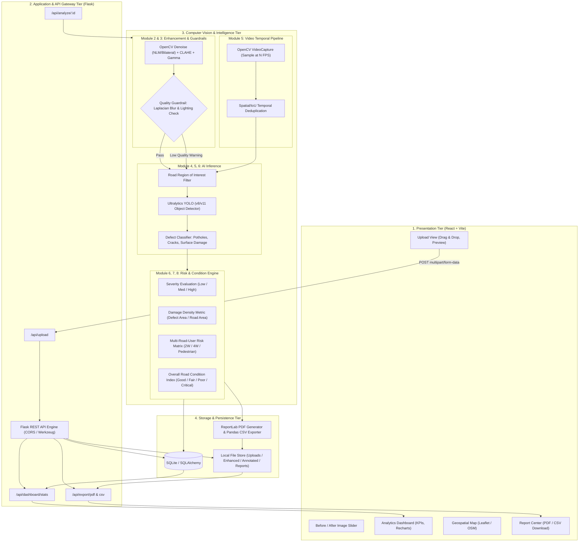
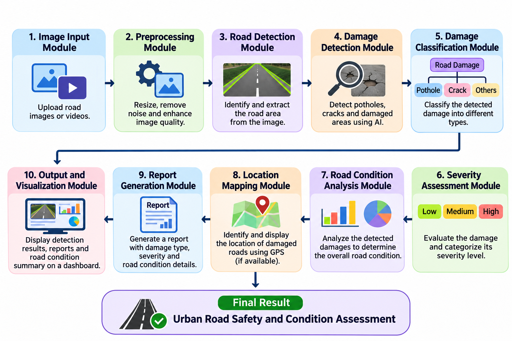
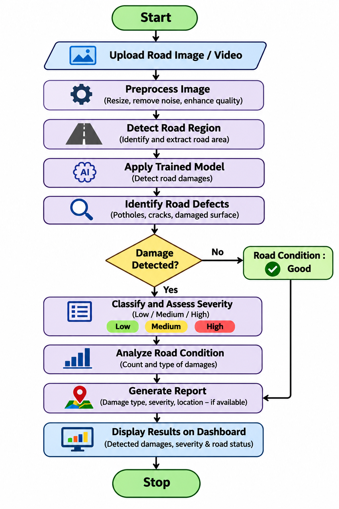
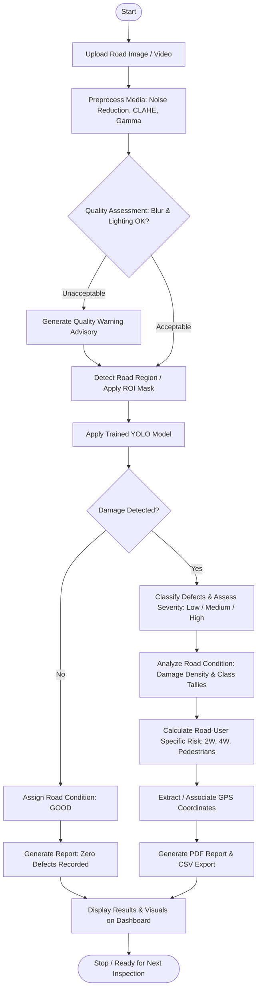
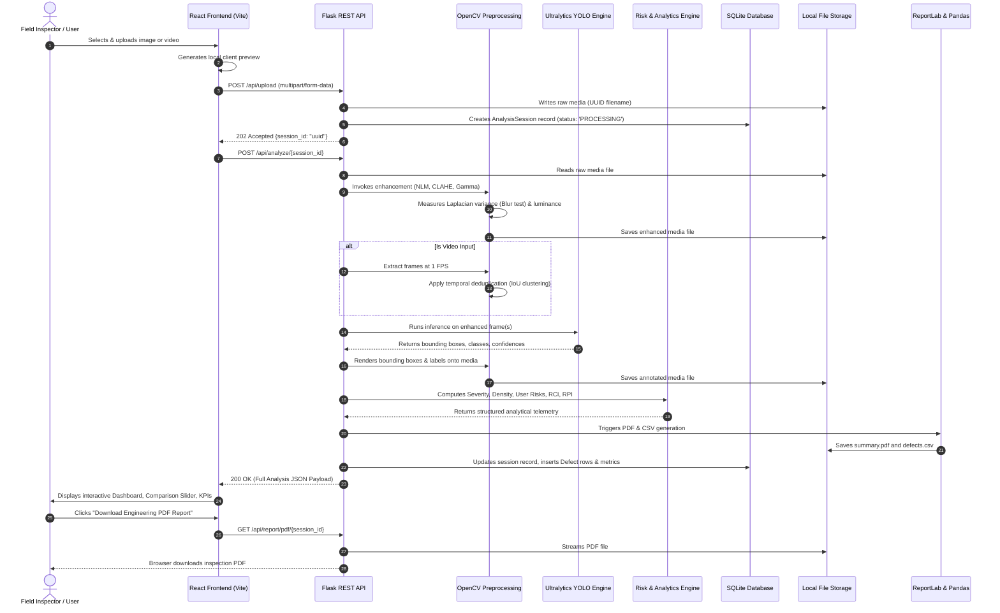
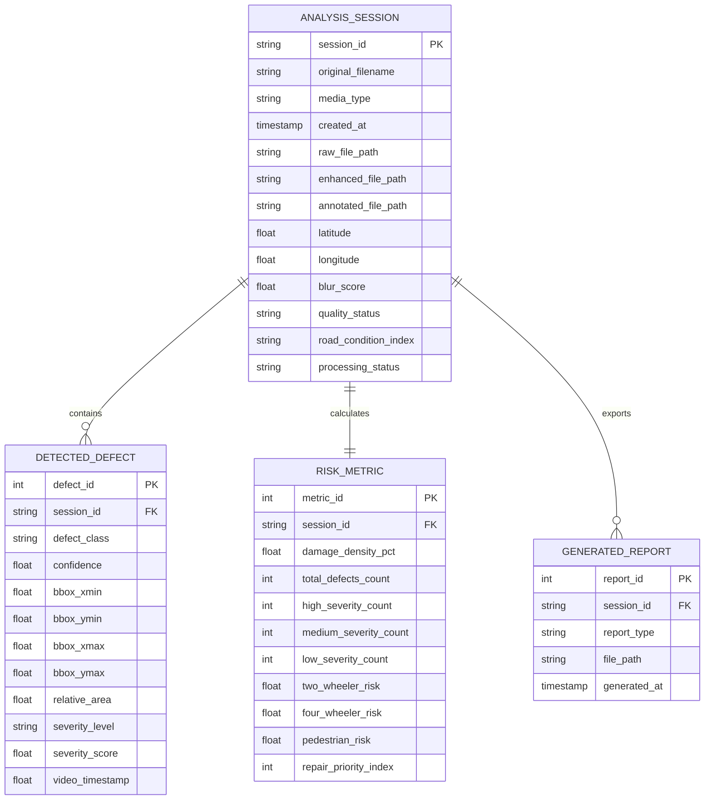
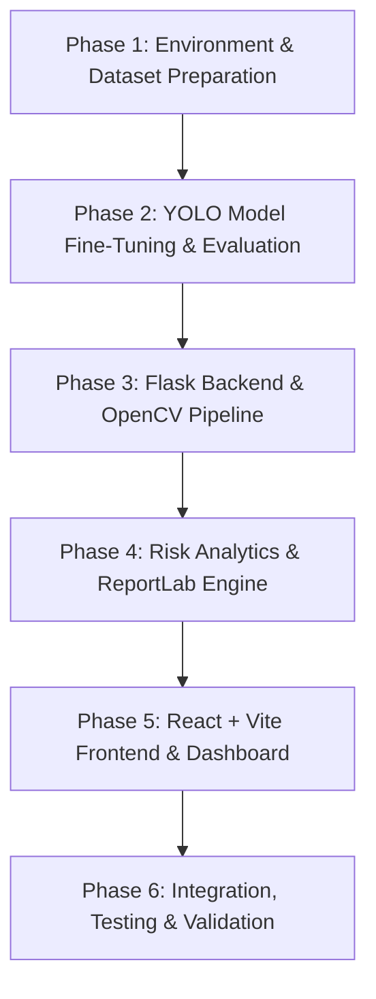

# StreetLens: Urban Road Safety and Condition Assessment Using Computer Vision
## Comprehensive System Architecture & Engineering Specification

> [!NOTE]
> **Project Title:** Urban Road Safety and Condition Assessment Using Computer Vision (**StreetLens**)  
> **Institution:** New Horizon College of Engineering — Autonomous College Permanently Affiliated to VTU  
> **Department:** Department of Computer Science & Engineering (Data Science)  
> **Course:** Mini Project (Course Code: `24CDS57`) | **Semester / Section:** 5th Semester ‘C’  
> **Authors:** Shreevatsa N J (`1NH24CD148`), Pavan R M (`1NH25CD412`)  
> **Faculty Guide:** Prof. Swathi Vinesh, Assistant Professor, Dept. of CSE (DS)

---

## 1. Executive Summary & Problem Context

Urban road infrastructure in developing metropolitan areas suffers from rapid wear and tear, yielding potholes, longitudinal/transverse fractures, alligator fatigue cracking, and uneven surface erosion. Traditional municipal inspection frameworks depend on manual foot and vehicular patrols, which are:
- **Operationally prohibitive**: Expensive in terms of human labor and inspection vehicle fleets.
- **Temporally lagging**: Weeks or months elapse between defect emergence and municipal recording.
- **Subjective & prone to omission**: Minor fissures and early-stage potholes are easily overlooked in high-speed or poor-visibility inspections.
- **Accident catalysts**: Road damage leads directly to vehicular suspension failure, loss of vehicle control, pedestrian tripping hazards, and fatal accidents—disproportionately affecting two-wheelers.

**StreetLens** resolves these challenges by delivering an automated, end-to-end Computer Vision and Deep Learning pipeline. Operating on uploaded single images or video recordings, StreetLens performs pre-inferencing visual quality enhancement, defect detection and localization via deep convolutional architectures (YOLO), mathematical severity scoring, multi-road-user hazard quantification, and interactive dashboard analytics with automated engineering report generation (PDF and CSV).

---

## 2. Complete Technology Stack Matrix

The project's technology stack is designed to strike an optimal balance between high inferencing throughput, modular backend computation, and an intuitive, responsive frontend experience.

| Subsystem | Technology | Purpose & Implementation Details | Category |
| :--- | :--- | :--- | :--- |
| **Frontend UI** | **React 18+ (JSX)** | Modular, component-driven user interface (Upload, Video Player, Comparison Slider, Dashboard, Reports). | Core |
| **Build & Tooling** | **Vite** | Modern, ultra-fast frontend build tool and local HMR dev server. | Core |
| **Languages** | **JavaScript (ES6+) / HTML5 / CSS3** | Client-side logic, asynchronous API handling, semantic UI structure, responsive viewport styling. | Core |
| **Styling Framework** | **Tailwind CSS** | Utility-first styling for rapid, clean design of cards, badges, modal dialogs, and KPI grids. | Core / Recommended |
| **Routing** | **React Router v6** | Client-side routing between `/`, `/upload`, `/analysis/:id`, `/dashboard`, and `/history`. | Core |
| **HTTP Communication** | **Axios / Fetch API** | Multipart form data uploads (`multipart/form-data`) with upload progress bars and polling/SSE status checks. | Core |
| **Data Visualization** | **Recharts / Chart.js** | Interactive charts for defect type distribution, severity breakdown, road-user risk comparison, and historical trendlines. | Core |
| **Iconography** | **Lucide React** | Consistent SVG icons for uploads, navigation, hazard severity alerts, and report downloads. | Core |
| **Backend Framework** | **Python 3.10+ & Flask** | RESTful backend serving micro-endpoints for upload, pipeline execution, analytical queries, and file streaming. | Core |
| **CORS Middleware** | **Flask-CORS** | Cross-Origin Resource Sharing handling across frontend (`localhost:5173`) and backend (`localhost:5000`). | Core |
| **Request Handling** | **Werkzeug** | Secure filename sanitization (`secure_filename`) and multi-part upload streaming. | Core |
| **Data Validation** | **Pydantic** | Strict schema validation for incoming payloads and outbound JSON telemetry responses. | Optional / Recommended |
| **AI / Object Detection** | **Ultralytics YOLO (v8 / v11)** | Real-time object detection identifying bounding boxes, classification labels, and confidence probabilities for road defects. | Core |
| **Deep Learning Engine** | **PyTorch (CUDA / CPU)** | Tensor acceleration framework executing model weights with automatic fallback to CPU if CUDA is unavailable. | Core |
| **Computer Vision Core** | **OpenCV (`cv2`)** | Non-Local Means / Bilateral denoising, CLAHE contrast equalization, Laplacian blur estimation, frame extraction, bounding box rendering. | Core |
| **Image Manipulation** | **Pillow (PIL)** | Complementary image loading, color profile normalization, thumbnail generation, and EXIF metadata extraction. | Core |
| **Numerical Processing** | **NumPy & Pandas** | Vectorized array operations for image statistics, coordinate normalization, defect frequency aggregation, and tabular export. | Core |
| **Database & ORM** | **SQLite & SQLAlchemy** | Zero-configuration relational storage of analysis sessions, defect records, severity metrics, and report file links. | Core |
| **Document Generation** | **ReportLab** | Programmatic PDF report rendering with styled typography, KPI tables, defect tallies, and high-resolution annotated image snapshots. | Core |
| **Geospatial Mapping** | **Leaflet / React-Leaflet & OpenStreetMap** | Interactive mapping of geolocated road defects using extracted EXIF GPS coordinates or user-provided road markers. | Optional / Recommended |
| **Testing & Quality** | **pytest** | Automated test suites for enhancement algorithms, risk formula verification, API mock testing, and schema validation. | Core |

---

## 3. High-Level Multi-Tier System Architecture

The architecture conforms to a decoupled **Four-Tier Architecture**:
1. **Presentation Tier (Client)**: Single Page Application (SPA) providing media upload interfaces, real-time analysis status, interactive side-by-side comparison, charts, and downloadable artifacts.
2. **Application & API Gateway Tier**: Flask REST server orchestrating pipeline tasks, handling authentication/session routing, file validation, and dispatching processing jobs.
3. **Core Processing & AI Engine**: Asynchronous execution pipeline executing image/video preprocessing, OpenCV quality filtering, YOLO inferencing, and Python analytical scoring.
4. **Data Persistence & Reporting Tier**: Relational SQLite storage, local file storage partitions (`uploads/`, `enhanced/`, `annotated/`, `reports/`), and ReportLab document generators.



---

## 4. Detailed End-to-End Processing Steps (The 10 Functional Modules)



The overall system workflow implements the 10 distinct modules defined in the project design:

```mermaid
flowchart LR
    M1["1. Image/Video Input"] --> M2["2. Preprocessing & Enhancement"]
    M2 --> M3["3. Road Detection & ROI"]
    M3 --> M4["4. Damage Detection (YOLO)"]
    M4 --> M5["5. Damage Classification"]
    M5 --> M6["6. Severity Assessment"]
    M6 --> M7["7. Road Condition Analysis"]
    M7 --> M8["8. Location Mapping (GPS)"]
    M8 --> M9["9. Report Generation"]
    M9 --> M10["10. Dashboard & Visualization"]
```



### Step 1: Media Ingestion & Validation Module
- **Input Types**: High-resolution digital still imagery (`.jpg`, `.jpeg`, `.png`) and vehicle dashcam/smartphone road video recordings (`.mp4`, `.avi`, `.mov`).
- **Validation**:
  1. Inspect MIME types and magic bytes to prevent arbitrary file upload vulnerabilities.
  2. Enforce size limits (e.g., $\le 25\text{ MB}$ for single images, $\le 200\text{ MB}$ for video files).
  3. Generate unique UUIDv4 tokens for every session (`session_id`) and sanitize storage paths with Werkzeug.
  4. Extract EXIF GPS metadata (Latitude, Longitude, Altitude, Capture Timestamp) using Pillow/Piexif when available.

### Step 2: Media Enhancement & Preprocessing Module
Raw road footage captured under real-world conditions often contains high-frequency sensor noise, shadow occlusion, low dynamic range, and lens distortion.
- **Denoising**: 
  - Non-Local Means Denoising (`cv2.fastNlMeansDenoisingColored`) removes asphalt grain while preserving sharp crack boundaries.
  - Optional Bilateral Filter (`cv2.bilateralFilter`) provides edge-preserving smoothing with lower computational overhead.
- **Adaptive Contrast Equalization**: Contrast Limited Adaptive Histogram Equalization (**CLAHE**) applied to the Luminance channel in LAB color space (`cv2.cvtColor(img, cv2.COLOR_BGR2LAB)`). This prevents global over-exposure while boosting shadowed pothole cavities.
- **Gamma Correction**: Dynamic luminance scaling $V_{\text{out}} = 255 \times (V_{\text{in}} / 255)^\gamma$ where $\gamma < 1.0$ brightens underexposed evening frames.
- **Edge Clarification**: Controlled unsharp masking enhances micro-crack fissures without introducing high-contrast hallucinated artifacts.
- **Dual Retention**: Both original and enhanced images are permanently retained to guarantee diagnostic auditability.

### Step 3: Quality Assessment & Input Guardrails
Before delegating frames to the computationally heavy detection network, an automated quality gate computes image suitability:
1. **Sharpness & Blur Estimation**: Calculated via the variance of the Laplacian operator:
   $$\text{Blur Metric } B = \text{Var}\left( \nabla^2 I_{\text{gray}} \right)$$
   If $B < \tau_{\text{blur}}$ (e.g., threshold $\approx 100$), the system tags the frame with a `BLURRY_INPUT_WARNING` without failing catastrophically.
2. **Luminance & Contrast Range**: Assesses mean pixel intensity $\mu_I$ and standard deviation $\sigma_I$. Frames with $\mu_I < 30$ (too dark) or $\mu_I > 230$ (severe glare) receive quality advisories.
3. **Resolution Adequacy**: Verifies minimum dimension requirements ($\ge 640 \times 640\text{ px}$) for optimal YOLO feature pyramid scaling.

### Step 4: Road Detection & Region of Interest (ROI) Module
To eliminate false-positive detections occurring on sidewalk pavers, roadside walls, sky backgrounds, or tree canopies:
- A trapezoidal perspective mask or semantic segmentation mask isolates the active asphalt corridor.
- Edge boundaries and horizon lines are filtered out, restricting defect feature extraction strictly to the drivable surface.

### Step 5: Video Handling & Temporal Deduplication Engine
For video uploads, processing each frame independently causes massive computational redundancy and overcounts static defects.
- **Frame Extraction**: `cv2.VideoCapture` samples frames at a configurable sampling frequency (e.g., $1.0\text{ Hz}$ or every $k$-th frame).
- **Temporal Alignment**: Every sampled frame is assigned an exact timestamp offset (`hh:mm:ss`).
- **Spatial Deduplication**: A custom spatial tracking heuristic computes the Intersection-over-Union (IoU) and centroid displacement between bounding boxes across adjacent sampled frames. If an identified pothole appears in frame $t$ and frame $t+1$ with $\text{IoU} \ge 0.45$, it is merged into a single unique hazard entity rather than double-counted.

### Step 6: AI Damage Detection & Localization Module
- **Engine**: Ultralytics YOLOv8 / YOLOv11 trained on road damage datasets (e.g., the Road Damage Dataset RDD2020/RDD2022).
- **Core Defect Classes**:
  1. `Pothole`: Cavities and structural depressions in the asphalt.
  2. `Longitudinal Crack`: Linear cracks parallel to the road travel direction.
  3. `Transverse Crack`: Linear cracks perpendicular to the road travel direction.
  4. `Alligator Crack`: Interconnected fatigue/crocodile cracking indicating base structural failure.
  5. `Damaged Surface / Ravelling`: Aggregate loss and coarse surface disintegration.
- **Output Vector**: For each detected defect $i$:
  $$\mathbf{D}_i = \left( c_i,\, p_i,\, x_{\min},\, y_{\min},\, x_{\max},\, y_{\max} \right)$$
  where $c_i \in \text{Classes}$, $p_i \in [0, 1]$ is the prediction confidence, and coordinates define the bounding box.

### Step 7: Severity Assessment Module
Raw bounding boxes alone do not inform municipal engineers of repair urgency. StreetLens computes a composite severity metric for each defect based on:
1. **Relative Dimension Ratio**: Bounding box area relative to estimated road surface area:
   $$A_{\text{rel}, i} = \frac{(x_{\max} - x_{\min}) \cdot (y_{\max} - y_{\min})}{W_{\text{road}} \cdot H_{\text{road}}}$$
2. **Defect Hazard Weighting ($w_{c}$)**: Assigned based on civil engineering hazard profiles:
   - Alligator Crack / Severe Pothole: $w_c = 1.00$
   - Longitudinal / Transverse Crack: $w_c = 0.65$
   - Surface Ravelling: $w_c = 0.40$
3. **Severity Score Calculation**:
   $$\text{Score}_i = w_c \cdot \left( \alpha \cdot A_{\text{rel}, i} + \beta \cdot p_i \right)$$
4. **Classification Thresholds**:
   - $\text{Score}_i < 0.35 \implies$ **Low Severity** (Routine monitoring)
   - $0.35 \le \text{Score}_i < 0.70 \implies$ **Medium Severity** (Scheduled maintenance)
   - $\text{Score}_i \ge 0.70 \implies$ **High Severity** (Immediate structural hazard / critical intervention)

### Step 8: Road Condition Analysis & Road-User Risk Engine
Aggregating individual defect detections into road-segment intelligence:
- **Damage Density Metric**:
  $$\text{Damage Density } (\%) = \left( \frac{\sum_{i=1}^N \text{Area}(\mathbf{D}_i)}{\text{Area}(\text{Road Surface})} \right) \times 100\%$$
- **Overall Road Condition Index (RCI)**:
  - If $N_{\text{defects}} = 0 \implies$ **Good** (Sound road condition)
  - If $\text{Density} < 2\%$ and High Severity $= 0 \implies$ **Fair**
  - If $2\% \le \text{Density} < 6\%$ or High Severity $\le 2 \implies$ **Poor**
  - If $\text{Density} \ge 6\%$ or High Severity $> 2 \implies$ **Critical Hazard**
- **Road-User Specific Risk Profiling**:
  - **Two-Wheelers (Bicycles & Motorcycles)**: Vulnerability is heightened by deep potholes and longitudinal cracks (steering entrapment). Risk index weights crack length and cavity depth heavily.
  - **Four-Wheelers (Cars & Commercial Vehicles)**: Vulnerability dominated by wide potholes and multiple fatigue cracks causing wheel rim and axle fracture.
  - **Pedestrians**: Vulnerability focused on crosswalk zones, shoulder fractures, and trip hazards.
- **Repair Priority Index (RPI)**: Outputs an actionable integer priority rating from $1$ (Lowest) to $5$ (Urgent Emergency).

### Step 9: Location Mapping Module (GIS Integration)
- Evaluates GPS coordinates extracted from media EXIF data or user manual input.
- Displays interactive OpenStreetMap tiles via Leaflet.
- Places color-coded map pins corresponding to segment health:
  - 🟢 Green: Good condition
  - 🟡 Yellow: Fair / Low-Medium defects
  - 🔴 Red: Critical / Severe potholes detected
- Allows municipal teams to visualize spatial defect clusters across urban corridors.

### Step 10: Multi-Format Report Generation & Visualization Module
- **PDF Report Generation (ReportLab)**:
  - Header with institutional insignia and project tracking numbers.
  - Media metadata (capture date, GPS coordinate stamp, resolution).
  - Pre-inference quality validation scorecard.
  - High-resolution annotated image highlighting detected bounding boxes and class tags.
  - Tabular defect ledger (Defect ID, Class, Confidence %, Severity Level, Estimated Dimensions).
  - Road-User Risk Breakdown & Recommended Maintenance Action Plan (e.g., Cold Asphalt Patching, Crack Sealing, Full Resurfacing).
- **Tabular CSV Export (Pandas)**:
  - Granular machine-readable rows ready for municipal asset management databases.
- **Interactive React Dashboard**:
  - KPI metric cards, interactive before/after enhancement comparison slider, Recharts defect distribution breakdown, and historical inspection timeline.

---

## 5. System Execution Flowchart





---

## 6. End-to-End Sequence Diagram



---

## 7. Database Entity Relationship Model (ER Schema)



---

## 8. REST API Interface Specification

### `POST /api/upload`
- **Description**: Ingests road images or video files, validates headers, assigns UUID, extracts EXIF coordinates.
- **Request**: `multipart/form-data` with field `file: <binary>`.
- **Response**:
```json
{
  "status": "success",
  "session_id": "7b2e35a1-4389-4d61-b51f-61c0cfa82d49",
  "filename": "highway_sample_01.jpg",
  "media_type": "image",
  "gps": {
    "latitude": 12.9352,
    "longitude": 77.6944
  },
  "created_at": "2026-11-21T14:35:00Z"
}
```

### `POST /api/analyze/{session_id}`
- **Description**: Triggers enhancement, quality checks, YOLO defect detection, and analytics calculation.
- **Response**:
```json
{
  "session_id": "7b2e35a1-4389-4d61-b51f-61c0cfa82d49",
  "quality": {
    "blur_score": 142.6,
    "lighting_status": "NORMAL",
    "advisory": null
  },
  "summary": {
    "total_defects": 3,
    "road_condition": "POOR",
    "damage_density_pct": 4.12,
    "repair_priority": 4
  },
  "risk_breakdown": {
    "two_wheeler_risk": 82.5,
    "four_wheeler_risk": 64.0,
    "pedestrian_risk": 35.0
  },
  "defects": [
    {
      "defect_id": 1,
      "class": "Pothole",
      "confidence": 0.89,
      "bbox": [120, 340, 260, 480],
      "severity": "HIGH",
      "severity_score": 0.82
    },
    {
      "defect_id": 2,
      "class": "Longitudinal Crack",
      "confidence": 0.74,
      "bbox": [310, 200, 345, 590],
      "severity": "MEDIUM",
      "severity_score": 0.54
    }
  ],
  "media_urls": {
    "original": "/static/uploads/7b2e35a1_raw.jpg",
    "enhanced": "/static/enhanced/7b2e35a1_enh.jpg",
    "annotated": "/static/annotated/7b2e35a1_ann.jpg"
  }
}
```

### `GET /api/report/pdf/{session_id}`
- **Description**: Streams the generated ReportLab PDF document containing the executive summary, annotated imagery, and municipal repair action items.

### `GET /api/report/csv/{session_id}`
- **Description**: Streams the tabular defect inventory in CSV format.

---

## 9. Mathematical Formulations & Rule Engines

### A. Blur & Sharpness Guardrail (Laplacian Variance)
$$\nabla^2 I = \frac{\partial^2 I}{\partial x^2} + \frac{\partial^2 I}{\partial y^2}$$
$$B(I) = \frac{1}{M \cdot N} \sum_{x=1}^M \sum_{y=1}^N \left( \nabla^2 I(x, y) - \overline{\nabla^2 I} \right)^2$$
Where $\tau_{\text{blur}} = 100$. If $B(I) < \tau_{\text{blur}}$, the image is flagged as motion-blurred.

### B. Damage Surface Density
$$\text{Density} = \left( \frac{\sum_{i=1}^N (x_{\max, i} - x_{\min, i}) \cdot (y_{\max, i} - y_{\min, i})}{W_{\text{road}} \cdot H_{\text{road}}} \right) \times 100\%$$

### C. Road-User Specific Risk Formulations
- **Two-Wheeler Risk ($R_{2W}$)**:
  $$R_{2W} = \min\left(100,\, \sum_{i=1}^N \left[ 40 \cdot \mathbb{I}(c_i = \text{Pothole}) \cdot S_i + 25 \cdot \mathbb{I}(c_i = \text{LongCrack}) \cdot S_i + 15 \cdot \mathbb{I}(c_i = \text{Other}) \cdot S_i \right]\right)$$
- **Four-Wheeler Risk ($R_{4W}$)**:
  $$R_{4W} = \min\left(100,\, \sum_{i=1}^N \left[ 35 \cdot \mathbb{I}(c_i = \text{Pothole}) \cdot S_i + 25 \cdot \mathbb{I}(c_i = \text{AlligatorCrack}) \cdot S_i + 10 \cdot \mathbb{I}(c_i = \text{Other}) \cdot S_i \right]\right)$$
- **Pedestrian Risk ($R_{\text{Ped}}$)**:
  $$R_{\text{Ped}} = \min\left(100,\, \sum_{i=1}^N \left[ 30 \cdot \mathbb{I}(c_i = \text{Pothole}) \cdot S_i + 15 \cdot \mathbb{I}(c_i = \text{AllCracks}) \cdot S_i \right]\right)$$

---

## 10. Step-by-Step Implementation Roadmap



1. **Phase 1: Environment & Dataset Ingestion**
   - Setup Python virtual environment (`venv`) and install `torch`, `torchvision`, `ultralytics`, `opencv-python`, `flask`, `reportlab`.
   - Acquire and clean road defect datasets (RDD2020 / Roboflow YOLO format).
2. **Phase 2: Model Training & Evaluation**
   - Fine-tune YOLOv8/v11 on road defect classes (Pothole, Cracks, Ravelling).
   - Evaluate against held-out validation set for **Precision**, **Recall**, **F1-score**, and **mAP@0.5**.
3. **Phase 3: Flask Backend & OpenCV Pipeline**
   - Implement enhancement routines (NLM, CLAHE, Gamma, Laplacian blur filter).
   - Construct `/api/upload` and `/api/analyze` endpoints with SQLite persistence.
4. **Phase 4: Analytics Engine & PDF Reporting**
   - Implement custom Python scoring algorithms (Severity, Density, Road-User Risk).
   - Design ReportLab PDF layout and Pandas CSV generation.
5. **Phase 5: React + Vite Frontend Development**
   - Scaffold React app with Vite and Tailwind CSS.
   - Build file upload zone with drag-and-drop and video preview.
   - Implement side-by-side comparison slider (Original vs Enhanced vs Annotated).
   - Build KPI overview cards, Recharts visualizations, and Leaflet map view.
6. **Phase 6: Integration & Verification**
   - Execute end-to-end integration tests using `pytest`.
   - Validate full flow: Upload $\rightarrow$ Enhancement $\rightarrow$ Quality Gate $\rightarrow$ YOLO Detection $\rightarrow$ Severity Engine $\rightarrow$ Dashboard $\rightarrow$ PDF Report download.
