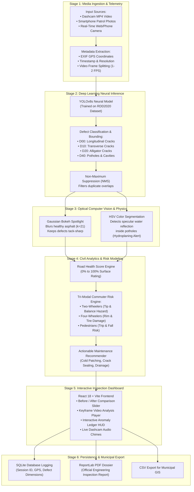

# StreetLens • End-to-End System Workflow

This document provides a comprehensive, step-by-step guide to the **operational and data workflow** of **StreetLens: Autonomous AI Road Surface Inspection & Hazard Assessment System**.

---

## 1. High-Level Workflow Diagram

The diagram below illustrates the exact sequence of data flow through the 6 stages of StreetLens:

---

## 2. Detailed Stage-by-Stage Operational Breakdown

### Stage 1: Media Ingestion & Metadata Telemetry
1. **Input Options**:
   - **Patrol Smartphone / Dashcam Video**: Upload an `.mp4` drive recording.
   - **Static Inspection Images**: Upload `.jpg` or `.png` pavement photos.
   - **Real-Time Dashcam Stream**: Mount a phone or laptop webcam on any dashboard for continuous frame scanning.
2. **Preprocessing**:
   - For images: Pillow (`PIL`) reads the image binary, auto-corrects orientation, and extracts **EXIF GPS latitude, longitude, and capture timestamp**.
   - For videos: OpenCV (`cv2.VideoCapture`) parses video codecs, extracts keyframes at regular intervals (1–2 FPS) to balance thoroughness with sub-second processing speed.

---

### Stage 2: Deep Learning Neural Inference (YOLOv8s)
1. **Input Normalization**: Image frames are resized to a normalized $640 \times 640$ tensor with RGB normalization.
2. **Neural Backbone & Feature Pyramid**:
   - YOLOv8 extracts spatial features at multiple scales, detecting both micro-fissures and large road cavities.
   - Trained on the **RDD2020 (Road Damage Detection) benchmark dataset** with 4 standardized classes:
     - **D00**: Longitudinal Cracks (parallel to traffic)
     - **D10**: Transverse Cracks (perpendicular to traffic)
     - **D20**: Alligator / Fatigue Cracking (interconnected web of fractures)
     - **D40**: Potholes & Structural Cavities
3. **Post-Processing (NMS)**:
   - Non-Maximum Suppression eliminates overlapping redundant bounding boxes, retaining only high-confidence detections.

---

### Stage 3: Optical Computer Vision & Physics
1. **Gaussian Bokeh Spotlight**:
   - Rather than just drawing raw boxes, StreetLens applies an **OpenCV Gaussian blur** ($k=21, \sigma=0$) to all non-damaged road asphalt.
   - The detected defect areas remain in 100% tack-sharp focus with corner reticle brackets.
   - **Civil Engineering Benefit**: Eliminates visual fatigue for road inspectors reviewing hundreds of kilometers of asphalt.
2. **Waterlogged Pothole Detection (HSV Color Segmentation)**:
   - Potholes filled with rainwater conceal their true depth and cause severe hydroplaning.
   - An adaptive HSV thresholding mask scans the bounding box pixels for low-saturation, specular reflective water surfaces.
   - If water is detected, the defect is tagged with an immediate **Hydroplaning & Two-Wheeler Hazard Alert**.

---

### Stage 4: Civil Engineering Analytics & Risk Modeling
1. **Road Health Score (0% to 100%)**:
   - Calculated through an explainable, data-driven civil formula:
     $$\text{Road Health Score} = 100 - (\text{Surface Damage Density \%} \times 0.8 + N_{\text{high}} \times 12 + N_{\text{medium}} \times 6)$$
   - Categorized as: **Good** ($>80\%$), **Fair** ($60\text{--}80\%$), **Poor** ($40\text{--}60\%$), or **Critical** ($<40\%$).
2. **Tri-Modal Commuter Vulnerability**:
   - Evaluates road hazard through 3 distinct lenses:
     - 🏍️ **Two-Wheelers**: Narrow tires catch in cracks; waterlogged potholes cause fatal balance loss.
     - 🚗 **Four-Wheelers**: High-speed impact causes rim deformation, sidewall punctures, and sudden swerving into adjacent lanes.
     - 🚶 **Pedestrians**: Edge fissures and uneven pavement create severe tripping hazards at crossings.
3. **Actionable Civic Recommendations**:
   - Maps defect patterns to standardized municipal road repairs:
     - Potholes $\to$ **Hot/Cold Bituminous Patching**
     - Surface Cracks $\to$ **Elastomeric Crack Bitumen Sealing**
     - Waterlogging $\to$ **Shoulder Drainage Regrading**

---

### Stage 5: Interactive Inspection Dashboard
1. **Before / After Comparison Slider**:
   - Draggable vertical divider that lets engineers visually slide between raw road asphalt and the enhanced Bokeh Spotlight view.
2. **Keyframe Video Analysis Player**:
   - Synchronized timeline with defect bookmark timestamps; clicking any defect jumps the video directly to that hazard frame.
3. **Interactive Anomaly Ledger**:
   - Tabular list of all detected defects ranked by severity; hovering or clicking pins the defect HUD directly on the media.
4. **Live Dashcam Mode**:
   - Sub-100ms camera frame streaming, adaptive phone/screen sensitivity presets, and audible audio alert chimes upon hazard detection.

---

### Stage 6: Persistent Logging & Municipal Export
1. **SQLite Database Storage**:
   - Every inspection session logs timestamp, original filename, defect counts, GPS coordinates, road health score, and commuter risk levels.
2. **Official ReportLab PDF Dossier**:
   - Generates a multi-page formal municipal engineering audit report complete with:
     - Municipal inspection executive summary
     - Road Health Score & Repair Priority Index
     - Embedded spotlight defect photos with dimensions
     - Commuter vulnerability safety breakdown
3. **CSV GIS Export**:
   - Exports raw coordinates and defect metrics for direct ingestion into municipal GIS (Geographic Information System) databases.

---

## 3. Quick 30-Second Viva Summary

> *"StreetLens takes road video or photos, runs YOLOv8s trained on the RDD2020 dataset to detect cracks and potholes, applies an optical Bokeh blur to healthy asphalt while detecting submerged water puddles, calculates an explainable 0–100% Road Health Score and commuter risk rating for bikes, cars, and pedestrians, and generates an official engineering PDF audit report with one click."*
